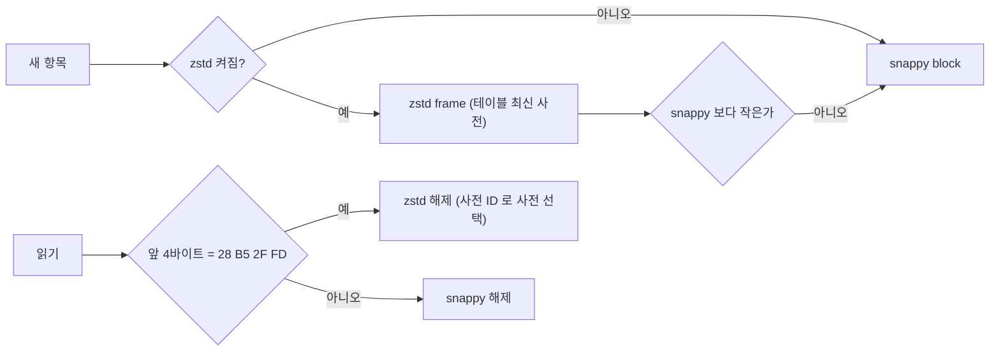
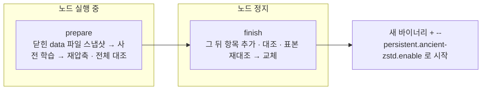

# orca-ancient-zstd

멈춘 nitro 노드의 저장소를 snappy 에서 zstd 로 옮기는 도구.

## 저장 형식

- ancient(freezer) 압축 테이블의 항목마다 snappy 또는 zstd 다. 한 파일 안에 섞여도 읽힌다.
- 사전은 테이블 폴더의 `<table>.<seq>.zdict`. 열 때 전부 읽고, 새 항목은 `seq` 가 가장 큰 사전으로 쓴다.
- 사전 파일을 지우면 그 사전으로 쓴 항목을 읽지 못한다. 사전은 데이터의 일부로 다룬다.
- pebble 은 sstable block 단위로 codec 이 기록된다. 옵션을 켜면 새 block 부터 zstd, 기존 block 은 compaction 이 다시 쓸 때 바뀐다.

## 노드 옵션

| 옵션 | 뜻 |
|---|---|
| `--persistent.ancient-zstd.enable` | ancient 새 항목을 zstd 로 |
| `--persistent.ancient-zstd.level` | 1 fastest · 2 default · 3 better (기본) · 4 best |
| `--persistent.ancient-zstd.tables` | 대상 테이블 (비우면 압축 테이블 전부) |
| `--persistent.pebble.zstd-databases` | zstd 로 쓸 pebble DB (`arbitrumdata`, `l2chaindata`, `wasm`) |

## 변환 절차

| 명령 | 노드 | 하는 일 |
|---|---|---|
| `prepare --dir <ancient>/chain --table bodies` | 실행 중 가능 | `.recompress/<table>.snap` 에 닫힌 data 파일 하드링크 + 잘린 index. 사전이 없으면 스냅샷으로 학습해 테이블 폴더에 설치. `.recompress/<table>` 에 재압축 · 전체 대조 |
| `finish --dir <ancient>/chain --table bodies [--delete-old]` | 정지 | prepare 뒤에 쌓인 항목 추가 · 대조, 준비분 표본 재대조, 교체. 옛 파일은 `.recompress/<table>.old` |
| `recompress --dir … --table … [--delete-old]` | 정지 | 사전 학습(없을 때) + prepare + finish 한 번에 |
| `train --dir … --table …` | 정지 | 사전만 학습 · 설치 |
| `compact --db <chain>/nitro/arbitrumdata` | 정지 | pebble 전체 compaction 을 zstd 로 |
| `bench --dir … --table …` | 정지 | 항목 읽기 시간 |

- 스냅샷은 flush 된 index 의 head 파일 앞까지만 잡는다. freezer 는 head 파일에만 덧붙이고, 비정상 종료 뒤에는 flush 지점 뒤 항목만 자르므로 스냅샷 안의 항목은 바뀌지 않는다.
- 하드링크라서 디스크를 추가로 쓰지 않는다 (같은 파일시스템, 파일 소유 계정으로 실행). 재압축본 크기만큼 여유가 필요하다.
- `train` 은 `zstd` CLI(`--train`) 가 PATH 에 있어야 한다.
- 교체 뒤에는 새 바이너리로만 열 수 있다 (옛 바이너리는 zstd 항목을 읽지 못한다). finish 와 바이너리 교체를 같은 정지 구간에서 한다.
- 중간에 멈추면 `.recompress/` 만 남고 원본은 그대로다.
