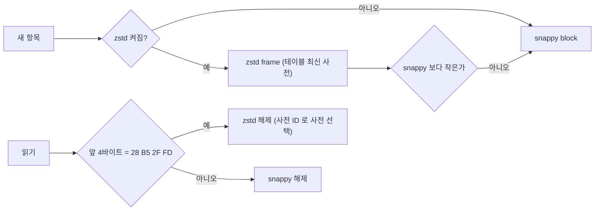

# orca-ancient-zstd

멈춘 nitro 노드의 저장소를 snappy 에서 zstd 로 옮기는 도구.

## 저장 형식

- ancient(freezer) 압축 테이블의 항목마다 snappy 또는 zstd 다. 한 파일 안에 섞여도 읽힌다.
- 사전은 테이블 폴더의 `<table>.<seq>.zdict`. 열 때 전부 읽고, 새 항목은 `seq` 가 가장 큰 사전으로 쓴다.
- 사전 파일을 지우면 그 사전으로 쓴 항목을 읽지 못한다. 사전은 데이터의 일부로 다룬다.
- pebble 은 sstable block 단위로 codec 이 기록된다. 옵션을 켜면 새 block 부터 zstd, 기존 block 은 compaction 이 다시 쓸 때 바뀐다.

## 노드 옵션

| 옵션 | 뜻 |
|---|---|
| `--persistent.ancient-zstd.enable` | ancient 새 항목을 zstd 로 |
| `--persistent.ancient-zstd.level` | 1 fastest · 2 default · 3 better (기본) · 4 best |
| `--persistent.ancient-zstd.tables` | 대상 테이블 (비우면 압축 테이블 전부) |
| `--persistent.pebble.zstd-databases` | zstd 로 쓸 pebble DB (`arbitrumdata`, `l2chaindata`, `wasm`) |

## 변환 절차 (노드 정지 중)

| 단계 | 명령 |
|---|---|
| 사전 학습 | `orca-ancient-zstd train --dir <ancient>/chain --table bodies` |
| 재압축 | `orca-ancient-zstd recompress --dir <ancient>/chain --table bodies --level 3 [--delete-old]` |
| pebble | `orca-ancient-zstd compact --db <chain>/nitro/arbitrumdata` |
| 읽기 측정 | `orca-ancient-zstd bench --dir <ancient>/chain --table bodies` |

- `train` 은 `zstd` CLI(`--train`) 가 PATH 에 있어야 한다.
- `recompress` 는 `<dir>/.recompress/<table>` 에 새 테이블을 만들고, 항목을 전부 옛 테이블과 대조한 뒤 교체한다. 옛 파일은 `<dir>/.recompress/<table>.old` 에 남는다 (`--delete-old` 면 지운다). 새 테이블 크기만큼 같은 파일시스템에 여유가 있어야 한다.
- 테이블 하나씩 진행한다. 중간에 멈추면 `.recompress/<table>` 만 남고 원본은 그대로다.
- 변환 뒤 노드를 `--persistent.ancient-zstd.enable` 로 띄워야 새 항목도 zstd 로 쓴다.
